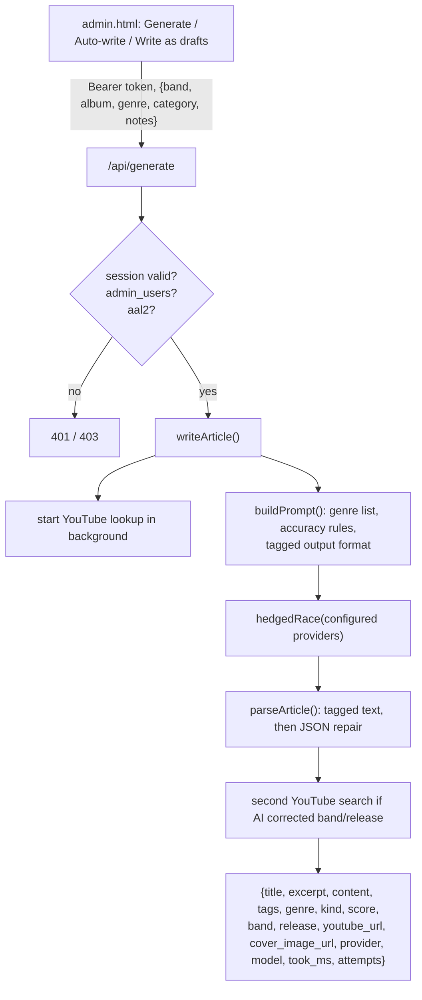

# AI system

Audited 2026-11-17. API keys are never written here. They live in Cloudflare Pages secrets.

## Providers

All providers are defined in `buildProviders()` in `functions/api/generate.js`. `track-info.js` reuses the same function.

| Key in `AI_PROVIDER_ORDER` | Enabled when | Default model (override variable) | API |
| --- | --- | --- | --- |
| `gemini` | `GEMINI_API_KEY` | `gemini-3.8-flash` (`GEMINI_MODEL`) | Google `generateContent`, `thinkingLevel: low`, max 4096 output tokens |
| `workersai` | binding `AI` | `@cf/meta/llama-3.3-70b-instruct-fp8-fast` (`WORKERSAI_MODEL`) | `env.AI.run`, 2000 tokens |
| `groq` | `GROQ_API_KEY` | `llama-3.3-70b-versatile` (`GROQ_MODEL`) | OpenAI-compatible |
| `openrouter` | `OPENROUTER_API_KEY` | `meta-llama/llama-3.3-70b-instruct:free` (`OPENROUTER_MODEL`) | OpenAI-compatible |
| `mistral` | `MISTRAL_API_KEY` | `mistral-large-latest` (`MISTRAL_MODEL`) | OpenAI-compatible |
| `deepseek` | `DEEPSEEK_API_KEY` | `deepseek-flash` (`DEEPSEEK_MODEL`) | OpenAI-compatible |
| `openai` | `OPENAI_API_KEY` | `gpt-6-astra` (`OPENAI_MODEL`) | OpenAI chat completions, `max_completion_tokens` 4000 |
| `claude` | `ANTHROPIC_API_KEY` | `claude-sonnet-5-5` (`CLAUDE_MODEL`) | Anthropic Messages, 2000 tokens |

- **Default order:** `gemini,workersai,groq,openrouter,mistral,deepseek,openai,claude`. Change it with the plain-text variable `AI_PROVIDER_ORDER`.
- **Actually in use:** the only verified evidence is the auto-draft run on 2026-11-16, where both drafts came from **`workersai`**. So Gemini is either not configured or failed on that run. Which other keys are set in Cloudflare is **not verifiable from the repo**: check Pages → Settings → Variables and Secrets.
- **Model names:** the defaults above are whatever the code says. Whether each vendor still offers that model name must be checked at the vendor. A wrong name shows up as that provider failing in the `attempts` list.

## Article generator: `POST /api/generate` (admin + 2FA)

- **Timeouts:**
  - whole AI phase `DEADLINE_MS` = 75 s
  - one provider `PROVIDER_TIMEOUT_MS` = 50 s
  - `HEDGE_DELAY_MS` = 15 s
- **Hedged race:**
  - The first provider in the order starts immediately.
  - If it **fails**, the next one starts right away.
  - If it is **slow** (15 s), the next one starts in parallel.
  - The first valid article wins and the others are aborted.
  - All failures come back in `attempts: [{provider, reason}]`, and the admin shows them in a toast.
- **Output format:** labelled lines `BAND:`, `RELEASE:`, `TITLE:`, `EXCERPT:`, `TAGS:`, `GENRE:`, `TYPE:` (Review / News / Feature / Interview), `SCORE:` (reviews only, 0–10), then `CONTENT:` with 350–500 words of Markdown and 2–3 `##` subheadings.
- **Parsing:** `parseArticle()` strips `<think>` blocks and code fences, reads the labels, and falls back to JSON with control-character repair.
- **Genre mapping:** the prompt contains `PROMPT_LIST` (the full taxonomy from `genres-data.js`), and the answer is normalised with `canonicalGenre()`. Unknown → "Underground".
- **YouTube:** with `YOUTUBE_API_KEY`, the Data API v3. Otherwise the public results page is parsed (6 s timeout). The thumbnail becomes `cover_image_url`. If nothing is found, a search link is returned.
- **Errors:**
  - 503 when no provider is configured
  - 502 "All AI providers failed" with `attempts`
  - 401 / 403 for authentication, admin and 2FA

The admin retries the network call once.

## Scene Radar Auto-write (admin)
- **One item:** **Auto-write** fills the generator form from the headline (band guess, `category = News`, notes with source, date, summary and "write in your own words"), sets `pendingSource`, presets the publication time to the source's time, and calls the generator. The editor reviews, then taps **Publish now**. A line `Source: [site](link)` is appended to the content.
- **Batch:** tick up to **5** headlines → **Write as drafts**.
  - Two run at a time.
  - Each result is inserted directly as `status = 'draft'`, with the source line, the source image or YouTube thumbnail, and `published_at` = the source time.
  - Slug conflicts (`23505`) are retried with a random suffix.
  - **Publish all** in the drafts banner publishes every AI draft (rows with a `Source:` line) after a confirmation. It keeps the stored `published_at`, or sets it to now.
- **Already written:** a headline whose link appears in any loaded article's content shows **✓ Written** and cannot be selected.

## No scheduled AI (since 2026-11-19)
At the owner's request every AI job that ran on its own was removed to save AI quota: the daily drafts
(`/api/auto-draft`, 06:43 WIT), the Telegram **Tulis draft / Publish / Buang** buttons and the Scene Radar
**autopilot** (#55–#56). AI now runs only when the editor presses a button in the admin.

## Telegram bot: `POST /api/telegram/digest` + `POST /api/telegram/webhook`
- **Digest:** GitHub Actions `.github/workflows/telegram-digest.yml` at 08:07, 14:07 and 20:07 WIT (or **Run workflow**) calls `/api/telegram/digest` with `AUTODRAFT_TOKEN`. It sends up to 5 new headlines tagged with our genres (not written up, not sent before; table `telegram_radar`), each with source, genres, summary and link. **No AI, no buttons.** The same call (re)registers the webhook.
- **Webhook:** answers `/start` from the owner's chat; buttons in older messages get "Tombol ini sudah tidak dipakai." and do nothing. The bot cannot write, publish or change anything.

## Music metadata: `POST /api/track-info` (admin + 2FA)
- **Input:** tags read in the browser by `assets/audiotags.js` (title, artist, album, year, genre, filename, duration).
- **Steps:**
  1. In parallel: the AI cleans names and picks a genre, and the catalogue lookup (iTunes Search, then Deezer) finds album, year, genre and official artwork.
  2. If the first catalogue lookup missed, it is retried with the AI-cleaned names.
- **AI part:** separate from the article race. At most the first 3 configured providers are tried **one after another**, 12 s each, `temperature 0.2`, 300 tokens. The JSON is extracted from the reply.
- **Genre:** AI genre → tag genre → catalogue genre → "Underground", always through `canonicalGenre()`.
- **Result:** always returns a best guess. Every step may fail without breaking the upload.

## Covers for charts: `GET /api/cover`
No AI. iTunes, then Deezer, cached 7 days. Admin → Music → **Find missing covers** saves the found URLs on tracks.

## Adding a provider
1. In `buildProviders()` add an entry `{ enabled, model, run(signal) }`. For OpenAI-compatible APIs use `openAICompatible(url, key, model, std)`. `run` must return the raw text and throw on HTTP errors (use `safeJson` and `errorText`).
2. Add a model default and a `<NAME>_MODEL` override in the `m` map.
3. Add the key name to `DEFAULT_ORDER` if it should run by default.
4. Add the secret in Cloudflare (Secret type), redeploy, and generate once. The admin toast shows `provider` and any `attempts`.
5. If the provider's API host is called from the **browser** (it should not be; all calls are server-side), the CSP in `_headers` would also need it.
6. Document it in this file and in [DEPLOYMENT.md](DEPLOYMENT.md#environment-variables).

## Cost and quota notes
- Workers AI has a free daily allocation (10,000 neurons per day at the time of writing). One article costs roughly 2,500 input and 900 output tokens.
- Provider keys and quotas are the owner's. The router does not create accounts or quota.
