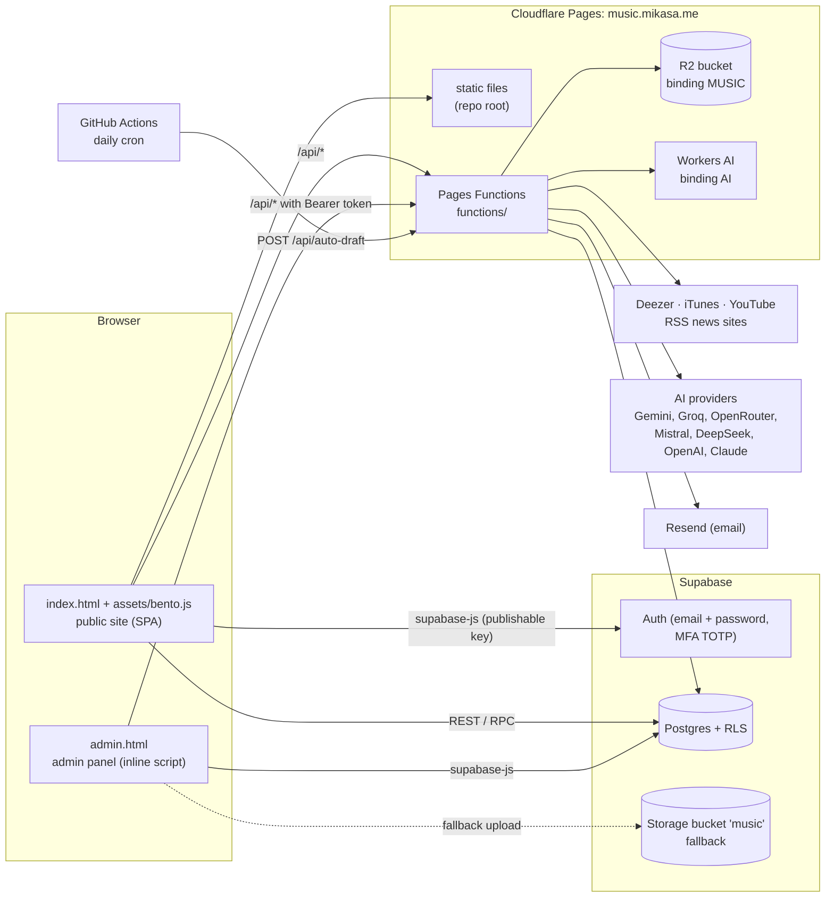
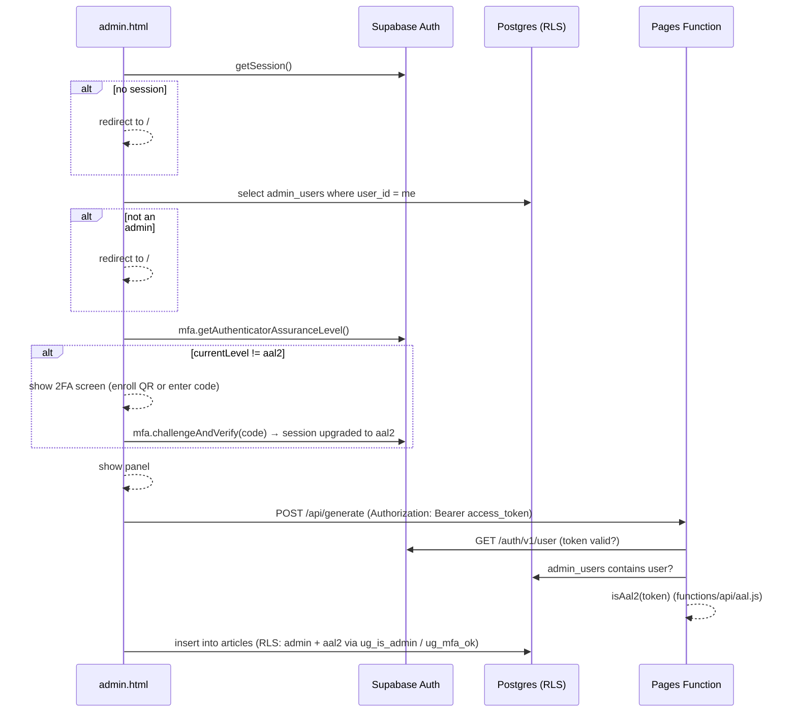

# Architecture and data flow

Audited against the code on `main` on 2026-11-17. Status labels are defined in [PROJECT-STATUS.md](PROJECT-STATUS.md#status-labels).

## 1. The big picture

UNDERGROUND is a **static site with serverless functions**:

- **No build step.** Cloudflare Pages serves the repository root as-is (build command empty, output directory `.`).
- **Pages Functions** (`functions/`) handle everything that needs a secret, a server-side API call, or SEO-friendly HTML.
- **Supabase** (Postgres + Auth + Storage) is the database. The browser talks to it directly with the public publishable key; **Row Level Security (RLS) is what protects the data**, not the frontend.
- **Cloudflare R2** stores music files (binding `MUSIC`). Supabase Storage is the fallback.
- **Free public APIs** (Deezer, iTunes, YouTube page, RSS feeds) provide charts, covers, band data and news.
- **AI providers** write articles and clean up music metadata. Their keys exist only in Cloudflare secrets.
- **GitHub Actions** triggers the daily AI drafts.

## 2. Frontend

### Public site: `index.html` + `assets/bento.js`
`bento.js` is one IIFE (about 1,700 lines) that runs the whole site as a single-page app.

| Area | How it works |
| --- | --- |
| Config | Top of `bento.js`: `SUPABASE_URL`, the **publishable** key (safe to be public; RLS protects data), `SUBMIT_EMAIL`, `TURNSTILE_SITE_KEY` (empty = captcha off). |
| Views | `home`, `articles`, `music`, `charts`, `about`, `account`, `band` (`<section id="view-…">` in `index.html`). |
| Routing | Views live in the hash (`/#/music`). Articles have real paths `/a/<slug>`, band pages `/band/<slug>`. `go()` uses `history.pushState`; `route()` handles back/forward. Old `/#/a/<slug>` links are rewritten to `/a/<slug>`. |
| Articles | Fetched from `articles` where `status = 'published'`, columns in `ACOLS`. Markdown is rendered by the small built-in `md()` after HTML escaping (no external Markdown library). A line that is only a YouTube URL becomes a `youtube-nocookie` embed. |
| Dashboard numbers | Counts, weekly bars, genre coverage, featured bands are computed in the browser from the published articles. |
| Scene radar ("Underground wire") | Reads `GET /api/news`. |
| Music | `tracks` (published) + a persistent mini player ("Floating Island" design) + full-screen Now Playing card. |
| Charts | Community charts via RPC `ug_chart_tracks` / `ug_chart_bands`; global charts via `GET /api/charts`; previews via `/api/preview`. |
| Accounts | Sign in, sign up, reset, profile, saved articles, comments, demos, rating, account deletion. |
| Search | `/` or Ctrl+K: articles (server `ilike` query), tracks and genres. `?q=` in the URL opens search. |
| Newsletter | Footer and article forms call RPC `ug_subscribe`. |
| Motion | `assets/launch.js` + `launch.css`: launch motion "09 Mosh Pit" on first open (short version on view changes). Off with `prefers-reduced-motion`. |
| Shared UI | `assets/ui.js` exposes `window.UI` (`esc`, `toast`). `assets/genres.js` exposes `window.UG_GENRES`. |

CSS: `assets/bento.css` (main theme "Neon Basement"), `assets/account.css` (Amp Head account page, rack-slide auth form), `assets/launch.css`, `assets/ui.css` (toasts etc.).

Cache busting: asset links carry `?v=` (for example `bento.js?v=ac1`). **Bump the `?v=` value in `index.html` whenever you change a CSS or JS file**, or phones keep the old file.

### Admin panel: `admin.html`
One HTML file with an inline `<script>` (about 1,600 lines). Tabs: **Articles** (AI generator, article form, Scene radar with batch drafts, article list, draft banner with Publish all, Demo inbox), **Music** (upload with auto-fill, track list, Find missing covers), **Settings** (Security check, Clean up data, newsletter subscribers and sender). See [SECURITY.md](SECURITY.md#admin-panel-protection) for how the page is protected.

## 3. Request paths

### 3.1 Reading public data
Browser → Supabase REST with the publishable key → RLS allows `select` on published rows only (articles, tracks, comments on published articles, profiles).

### 3.2 Authentication
Supabase Auth, email + password, with email confirmation. Sessions live in `localStorage` (supabase-js default). Details: [SECURITY.md](SECURITY.md#visitor-accounts).

### 3.3 Admin verification (three layers)

1. **Page**: `admin.html` stays invisible (`html.gate`) until the checks pass.
2. **Functions**: every admin route checks the token, `admin_users` membership, and the `aal2` claim.
3. **Database**: RLS rules require admin membership, and with `supabase/security.sql` also `aal2`.

The database layer is the one that matters. The other two give good error messages and stop work early.

### 3.4 Pages Functions (API)

| Route | Method | Who | What it does | Status |
| --- | --- | --- | --- | --- |
| `/a/<slug>` (`functions/a/[slug].js`) | GET | public | Serves `index.html` with the article's title, description, image, NewsArticle (+ Review) JSON-LD injected with HTMLRewriter | IMPLEMENTED, NOT VERIFIED (Google indexing still pending) |
| `/band/<slug>` (`functions/band/[slug].js`) | GET | public | Same for band pages | IMPLEMENTED, NOT VERIFIED |
| `/sitemap.xml` | GET | public | Home, legal pages, published articles, band pages | IMPLEMENTED, NOT VERIFIED |
| `/unsubscribe?t=` | GET, POST | public | Calls `ug_unsubscribe(token)`; POST supports one-click unsubscribe | IMPLEMENTED, NOT VERIFIED |
| `/api/news` | GET | public | Scene Radar RSS aggregator, 15 min edge cache | VERIFIED (New Noise blocked by captcha) |
| `/api/charts` | GET | public | Global charts from Deezer (`?group=`, `?genre=`), 6 h cache | VERIFIED (owner) |
| `/api/preview?id=` | GET | public | 302 to a fresh Deezer 30 s preview | VERIFIED (owner) |
| `/api/cover?a=&t=` | GET | public | Artwork from iTunes/Deezer, 7 day cache | IMPLEMENTED, NOT VERIFIED |
| `/api/band?name=` | GET | public | Deezer artist, top tracks, related, 24 h cache | IMPLEMENTED, NOT VERIFIED |
| `/api/generate` | POST | admin + aal2 | AI article generator | VERIFIED |
| `/api/track-info` | POST | admin + aal2 | Music metadata lookup + AI clean-up | IMPLEMENTED, NOT VERIFIED (since 2FA) |
| `/api/music/*` | GET/PUT/POST | file GET public, rest admin + aal2 | R2 upload, multipart, streaming, delete, purge | IMPLEMENTED, NOT VERIFIED (R2 binding not confirmed) |
| `/api/newsletter/send` | POST | admin + aal2 | Sends newsletter via Resend | VERIFIED (test email, before 2FA) |
| `/api/auto-draft` | POST | `AUTODRAFT_TOKEN` | Daily AI drafts | VERIFIED (run 43867308189) |

`functions/api/genres-data.js` and `functions/api/aal.js` export helpers only (no handler).

### 3.5 AI article generation
See [AI-SYSTEM.md](AI-SYSTEM.md).

### 3.6 Music upload and streaming
See [MUSIC-SYSTEM.md](MUSIC-SYSTEM.md).

### 3.7 Scene Radar
`/api/news` fetches 7 RSS feeds in parallel (8 s timeout each) and parses RSS/Atom with regexes (no DOM). Per feed it keeps at most 30 items, drops items older than 30 days, de-duplicates by title and link, and returns at most 80. Each item gets `genres` (keyword match for 7 genres) and `band` (heuristic guess from the headline). The result is cached 15 minutes, and `?refresh=1` bypasses the cache. Only headline, a summary of at most 45 words, image and link are returned.

Consumers:

- the public "Underground wire" card
- admin Scene radar: Auto-write one item, or select up to 5 and **Write as drafts**
- `/api/auto-draft`

### 3.8 Scheduled jobs
One workflow: `.github/workflows/auto-draft.yml`, cron `43 21 * * *` (UTC) = 06:43 WIT (UTC+9), plus manual dispatch. It POSTs to `https://music.mikasa.me/api/auto-draft` with the `AUTODRAFT_TOKEN` secret, retrying once after 60 s. Details: [AI-SYSTEM.md](AI-SYSTEM.md#scheduled-ai-drafts-post-apiauto-draft) and [DEPLOYMENT.md](DEPLOYMENT.md#github-actions).

### 3.9 Newsletter
- **Sign-up:** RPC `ug_subscribe(email, source)`. It validates the address, guards against floods (30 new sign-ups per minute site-wide), and stores `newsletter_subscribers`, each row with a private `token`.
- **Sending:** admin → Settings picks stories → `POST /api/newsletter/send` → Resend batch API. Every email gets a personal `List-Unsubscribe` link `/unsubscribe?t=<token>` and a reply-to address.

### 3.10 Charts and ratings
- **Community:** members rate published tracks 1–5 stars (`track_ratings`, one row per member per track). `ug_chart_tracks` ranks with a Bayesian average, `(sum + 3 × global mean) / (votes + 3)`. `ug_chart_bands` aggregates per artist. Period `week` = ratings updated in the last 7 days. An optional `p_genres` filter applies.
- **Global:** `/api/charts` builds Top 10 bands and hits from Deezer. By default it uses Deezer's "Metal" playlists, falling back to the Metal genre artists. With `group` or `genre` it uses the most relevant Deezer playlist for that genre. The cache key is `v=4`, and a build makes at most about 42 subrequests (the free plan limit is 50).

### 3.11 Band profiles
`/band/<slug>`: stories with that `band_name`, Basement radio tracks by that artist, average review score, members' rating (`ug_band_rating`), and Deezer data from `/api/band` (fans, top tracks with previews, related artists).

### 3.12 Gigs
**Removed from the website** (owner request). The `gigs` table and its policies still exist in `supabase/extras.sql` and are unused. `ug_admin_purge` still accepts the `gigs` target.
