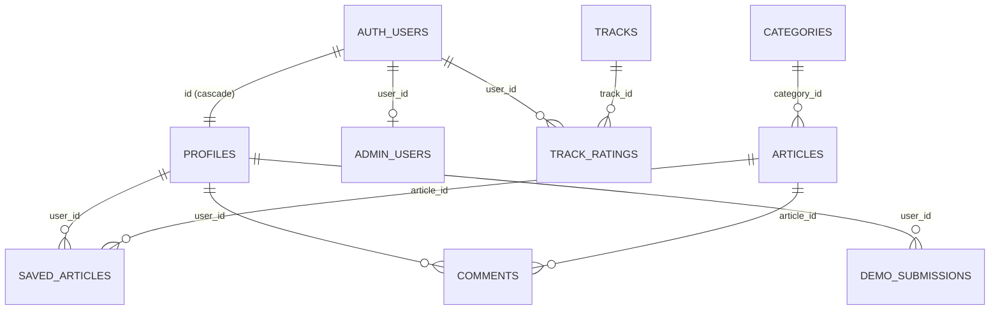

# Database (Supabase)

- Project ref `lhhmzfwjznlwkentbakv`, region Singapore.
- Postgres with Row Level Security (RLS) on every application table.
- Audited against `supabase/*.sql` on 2026-11-17.

> **The base schema is now in this repository** as `supabase/base.sql`. The tables `articles`, `categories` and `admin_users` were created in the Supabase dashboard before the SQL files existed; `base.sql` is the exact definition exported read-only from production on 2026-11-23 (columns, constraints, indexes, the RLS flag and every policy, including "Admins can read all articles" — see [section 6](#6-incident-insert-returning-blocked-by-rls-2026-11-17)). The prose in [section 2](#2-tables) is kept for readers; where it and `base.sql` disagree, `base.sql` wins. The export query in [section 7](#7-verifying-the-database) can be re-run at any time to re-verify.

## 1. SQL files and the order to apply them

Every file is idempotent ("safe to re-run"): `create … if not exists`, `create or replace`, and `drop policy if exists` before `create policy`. Run each one in Supabase → **SQL Editor**.

| # | File | Purpose | Depends on |
| --- | --- | --- | --- |
| 0 | `supabase/base.sql` | `articles`, `categories`, `admin_users` and their original dashboard policies — the real exported definition. Run this first. | — |
| 1 | `supabase/community.sql` | `ug_is_admin()`, `profiles` (+ sign-up trigger), `saved_articles`, `comments`, `demo_submissions`, rate-limit triggers | `articles` |
| 2 | `supabase/music.sql` | `tracks`, storage bucket `music` (25 MB, public read), storage policies, `ug_admin_purge()` | 1 |
| 3 | `supabase/music-v2.sql` | `tracks.album`, `tracks.release_year` + checks | 2 |
| 4 | `supabase/charts.sql` | `track_ratings`, `ug_chart_tracks`, `ug_chart_bands`, `ug_track_rating` | 2 |
| 5 | `supabase/extras.sql` | `articles.kind/score`, `ug_band_rating`, `newsletter_subscribers`, `ug_subscribe`, unsubscribe token + `ug_unsubscribe`, `ug_delete_my_account`, `gigs` (unused), `ug_admin_purge` (extended) | 1–4 |
| 6 | `supabase/security.sql` | Admin powers need 2FA: `ug_is_admin()` requires `aal2`, `ug_mfa_ok()`, restrictive policies on `articles` and `categories` | 1–5, **and the admin must have set up 2FA first** |
| 7 | `supabase/security-check.sql` | `ug_security_check()` diagnostic (read-only, test inserts rolled back) | 6 |
| 8 | `supabase/telegram.sql` | `telegram_radar` for the Telegram bot (service key only) | — |
| 9 | `supabase/themes.sql` | Theme Manager: `site_theme_active`, `site_theme_configs`, `site_theme_history`, `ug_clean_theme_tokens`, `ug_theme_id_ok`, `ug_active_theme`, `ug_apply_theme`, `ug_restore_theme`, `ug_reset_theme` | 6 (`ug_is_admin()` with 2FA). Applied by the owner on 2026-11-18 and verified. Do not re-run without a technical reason. |
| 10 | `supabase/news-ingestion.sql` | RSS publisher idempotency and publication tracking (`news_ingestion`) | Base `articles` table; pending until release approval |
| 11 | `supabase/music-v3-trim.sql` | Basement Radio cuts: `tracks.trim_start_ms`, `trim_end_ms`, `allow_full`, `waveform` + checks; `ug_chart_tracks` returns the cut (drop + create, new return type) | 2, 4. **Pending: owner reviews and runs it.** The site works before it runs (songs play in full). After it runs, re-running `charts.sql` fails on `ug_chart_tracks` (return type); re-run `music-v3-trim.sql` instead. |

Owner-reported state: files 6 and 7 applied on 2026-11-17 (2FA working; "Admins can read all articles" added in the dashboard); file 9 (`themes.sql`) applied and verified on 2026-11-18. The application status of files 1–5 and 8 is inferred from working features, not from a schema dump.

**Rebuilding from the repo is now possible.** Step 0 (`articles`, `categories`, `admin_users` and their dashboard policies) is `supabase/base.sql`, exported read-only from production on 2026-11-23 and verified to apply cleanly against production inside a rolled-back transaction. Files 1–9 were applied in order to an empty PostgreSQL 16 database with a stand-in for step 0 on 2026-11-19: all applied, and all re-ran without errors; RLS is on for all 15 tables.

⚠️ `community.sql`, `music.sql` and `security.sql` all define `ug_is_admin()`. Since 2026-11-17 **all three contain the 2FA version**. Never re-introduce the old body (admin membership only) in any file, or a re-run would silently drop the 2FA requirement.

| 12 | `supabase/20261120103205_create_ai_ingestion.sql` | VPS AI publisher idempotency and article audit trail (`ai_ingestion`); RLS on, client roles revoked, service-role only | Base `articles` table |
| 13 | `supabase/theme-font-list-fix.sql` | Repairs the `ug_clean_theme_tokens()` font allow-list in `themes.sql`, which was missing `anton` and `space-grotesk`. Run once; safe to re-run. `themes.sql` already carries the fix for future rebuilds, and `tests/themes.test.mjs` now fails if any SQL file's font/colour/key lists drift from `assets/theme/schema.js`. | 9 |

## 2. Tables

### `articles` *(see `supabase/base.sql`)*
Columns used by the code: `id` (type not documented; `community.sql` detects it at run time), `title`, `slug` (unique, so the code retries with a suffix on `23505`), `excerpt`, `content` (Markdown), `band_name`, `album_name`, `genre`, `category_id` → `categories.id`, `cover_image_url`, `tags` (array), `status` (`draft` | `review` | `published`), `published_at`, `created_at`, `updated_at`, `author_id` (auth user id), plus from `extras.sql`:

- `kind` text: `Review` | `News` | `Feature` | `Interview`, or null
- `score` numeric(3,1): 0–10, or null
- `youtube_video_id` text, nullable; exactly 11 YouTube video-id characters (`A–Z`, `a–z`, `0–9`, `_`, `-`), added by `20261121170000_ai_publish_media_fields.sql`

Conventions:

- **AI drafts** contain a line `\n\nSource: [<site>](<link>)`. The admin "AI drafts waiting" banner and "✓ Written" in Scene Radar rely on it.
- `published_at` may be preset to the source's original time.

### `categories` *(see `supabase/base.sql`)*
Used columns: `id`, `slug`. The admin looks up `category_id` by `slug = slugify(genre)`. Not every genre has a category row; null is allowed.

### `admin_users` *(see `supabase/base.sql`)*
Used column: `user_id` (auth user id). Membership = admin. Owner-reported RLS: a user can read only their own row. Rows are added by hand in the SQL editor (see [SECURITY.md](SECURITY.md#admin-membership)).

### `profiles` (`community.sql`)
`id` uuid PK → `auth.users.id` on delete cascade, `display_name` (2–40 chars), `favorite_genres` text[] (≤ 8), `created_at`, `updated_at`. Created automatically by trigger `ug_on_auth_user_created` → `ug_handle_new_user()` (name from sign-up metadata, else from the email). RLS: public read; users insert and update only their own row.

### `saved_articles` (`community.sql`)
`user_id` → `profiles.id` (cascade), `article_id` → `articles.id` (cascade), `created_at`; PK `(user_id, article_id)`. RLS: own rows only; saving is allowed only for published articles.

### `comments` (`community.sql`)
`id` uuid, `article_id` → `articles.id` (cascade), `user_id` → `profiles.id` (cascade), `body` (1–2000 chars), `created_at`. Index `comments_article_idx (article_id, created_at)`. Trigger `ug_comment_rate_limit`: at most 5 per member per minute. RLS: read on published articles; members insert as themselves on published articles; delete by author or admin.

### `demo_submissions` (`community.sql`)
`id`, `user_id` → `profiles.id` (cascade), `band_name`, `country`, `genre`, `link` (must be `https://…`), `message`, `contact_email`, `status` (`new` | `listened` | `featured` | `declined`), `created_at`. Index on `created_at desc`. Trigger `ug_demo_rate_limit`: at most 3 per member per day. RLS: members insert their own and see their own; admins see, update and delete all.

### `tracks` (`music.sql`, `music-v2.sql`, `music-v3-trim.sql`)
`id` uuid, `title`, `artist` (1–160), `genre` (≤ 40), `description` (≤ 1000), `audio_path`, `audio_url` (https), `cover_path`, `cover_url` (https), `duration_sec` (0–7200), `status` (`draft` | `published`), `published_at`, `created_at`, `updated_at`, `album` (≤ 160), `release_year` (1900–2100). Index `tracks_published_idx (status, published_at desc)`. RLS: published public (admins see all); admin insert, update and delete.

### `track_ratings` (`charts.sql`)
`track_id` → `tracks.id` (cascade), `user_id` → `auth.users.id` (cascade), `stars` 1–5, `created_at`, `updated_at`; PK `(track_id, user_id)`. Index `track_ratings_updated_idx`. RLS: members read their own and rate published tracks only. Aggregates are exposed only through security-definer RPCs.

### `newsletter_subscribers` (`extras.sql`)
`id`, `email` (validated; unique on `lower(email)`), `source`, `created_at`, `token` uuid (unique; used in unsubscribe links). RLS: **admins only** (select, delete). Inserts go only through `ug_subscribe`.

### `gigs` (`extras.sql`), unused
`id`, `title`, `bands` text[], `venue`, `city`, `starts_at`, `ticket_url`, `poster_url`, `price`, `description`, `status` (`draft` | `published`), `created_at`, `updated_at`; index `gigs_upcoming_idx (status, starts_at)`. The feature was removed from the site; the table remains. Do not build on it without asking the owner.

### Storage bucket `music` (`music.sql`)
Public read, 25 MB per file (`26214400`), audio and image MIME types only, admin-only writes through `storage.objects` policies. Used only when R2 is not available.

### `ai_ingestion` (`supabase/20261120103205_create_ai_ingestion.sql`)
Tracks VPS-generated article claims with normalized title, canonical source URL, processing status, article reference, band/release/genre/type/score metadata and timestamps. Unique indexes on `source_url` and `title_key` provide race-safe idempotency. RLS is enabled, no client policies exist, privileges are revoked from `PUBLIC`, `anon` and `authenticated`, and CRUD is granted only to `service_role`. The endpoint contract and VPS setup are documented in [AI-PUBLISHER.md](AI-PUBLISHER.md).

### `news_ingestion` (`supabase/news-ingestion.sql`)
Tracks RSS source URL/hash, title, source, source publication date, status (`processing` / `published` / `failed` / `skipped`), optional `article_id` → `articles.id`, attempts, last error, and creation/update/publication/Telegram-notification timestamps. RLS is enabled; grants are revoked from `anon` and `authenticated`; only the server service key uses it. Apply only after the publisher PR is approved for release.

### `telegram_radar` (`supabase/telegram.sql`)
Headlines the Telegram bot has sent: `hash` (pk, short SHA-256 of the link), `link`, `title`, `item` jsonb (headline, source, summary, date, image, band, genres), `status` (`sent` / `writing` / `drafted` / `skipped`), `article_id`, `sent_at`, `updated_at`. RLS on with **no policies** and grants revoked from `anon`/`authenticated`: only the server's service key uses it. Status: PENDING (owner must run the SQL).

### Theme Manager (`supabase/themes.sql`, applied 2026-11-18)
| Table | Contents | Visitors | Signed-in non-admin | Admin with 2FA |
| --- | --- | --- | --- | --- |
| `site_theme_active` | one row (`id = 1`): `theme_id`, `tokens`, `version`, `config_id`, `applied_by`, `applied_at` | no table access; read `{theme, tokens, version}` through `ug_active_theme()` | nothing | read; write only through the functions |
| `site_theme_configs` | saved configurations/drafts: `theme_id`, `name`, `tokens`, `note`, `created_by`, timestamps | none | none (RLS) | read, insert, update, delete |
| `site_theme_history` | every Apply/Restore/Reset: `action`, `theme_id`, `tokens`, `version`, `config_id`, `applied_by`, `applied_at`, `note` | none | none | read only |

- Privileges are revoked from `anon` and `service_role` on all three tables and on the history sequence; `authenticated` has only SELECT on active/history and S/I/U/D on configs, filtered by RLS (`ug_is_admin()`). `service_role` can call only `ug_active_theme()`.
- CHECK constraints `*_tokens_clean` make every stored `tokens` value equal to `ug_clean_theme_tokens(tokens)`, also for writes made by hand in the dashboard; `ug_active_theme()` cleans again on output and returns only `theme`, `tokens`, `version`.
- Apply uses one atomic upsert on the active row, so parallel applies get consecutive versions, also when the row was deleted.
- Tokens are cleaned by `ug_clean_theme_tokens()` (trigger on configs, and inside every apply). It mirrors `assets/theme/schema.js`; a parity test (`tests/themes.test.mjs`) now checks the font, colour and font-key allow-lists in every SQL file that defines it, so the two can no longer drift. **Change both together.**
- `ug_apply_theme(theme_id, tokens, config_id, note)`, `ug_restore_theme(history_id)`, `ug_reset_theme()` are SECURITY DEFINER with `search_path = ''`, check `ug_is_admin()` first, and write the active row + a history row in one transaction (`version` increases by 1 each time; parallel applies never share a version). The internal `ug_theme_write()` is not executable by any client role.
- Theme ids are checked against the catalogue in `ug_theme_id_ok()` (keep in sync with `THEMES` in `schema.js`). Whether a theme is ready is decided by the code; the site falls back to `neon-bento` for any theme that is not.
- Tested on PostgreSQL 16 with a Supabase-style setup (non-superuser owner, with and without BYPASSRLS; roles `anon`, `authenticated`, `service_role`), 2026-11-18: 49 security/behaviour checks (ownership, privilege matrix, RLS, 2FA, apply/restore/reset, 8 parallel applies with the row present and missing, no leaks from `ug_active_theme`, tamper attempts), validator parity on 273 inputs plus identical token and font lists, and two re-runs on a database with data (no change). Applied to production by the owner on 2026-11-18; Apply, Restore and Reset verified there (active version 5 on 2026-11-19).

## 3. Relationships



Band pages link articles and tracks **by name**, not by foreign key (`articles.band_name` matched with `ilike`; `tracks.artist` normalised in `ug_band_rating`). There is no `bands` table.

## 4. Functions (RPC) and triggers

| Function | Security | Called by | Purpose |
| --- | --- | --- | --- |
| `ug_is_admin()` | definer | RLS policies, `ug_admin_purge` | Caller is in `admin_users` **and** JWT `aal = 'aal2'` |
| `ug_mfa_ok()` | definer | restrictive policies (`security.sql`) | True for non-admins; for admins only with `aal2` |
| `ug_handle_new_user()` | definer, trigger on `auth.users` insert | Supabase Auth | Creates the profile |
| `ug_comment_rate_limit()` | definer, trigger | comments insert | 5 per minute |
| `ug_demo_rate_limit()` | definer, trigger | demo insert | 3 per day |
| `ug_admin_purge(text[])` | definer | admin Settings → Clean up data | Deletes `comments`, `saved`, `articles`, `tracks`, `demos`, `gigs` (needs `ug_is_admin`) |
| `ug_chart_tracks(period, limit, genres)` | definer | Charts | Bayesian-ranked tracks |
| `ug_chart_bands(period, limit, genres)` | definer | Charts | Ranked artists |
| `ug_track_rating(uuid)` | definer | player | Average and votes for one track |
| `ug_band_rating(text)` | definer | band page | Members' average for an artist |
| `ug_subscribe(email, source)` | definer | newsletter forms (anon) | Validated, flood-guarded insert |
| `ug_unsubscribe(uuid)` | definer | `/unsubscribe` function | Delete by token |
| `ug_delete_my_account()` | definer | Account page | Deletes the caller (refuses admins); cascades remove profile, comments, saves, ratings, demos; also removes their newsletter row |
| `ug_security_check()` | **invoker** | admin Settings → Security check | Reports `aal`, admin flags, two rolled-back test inserts, article policies |

## 5. RLS model and MFA

Two kinds of policies are combined:

- **Permissive** policies (the normal kind): *at least one* must pass. For example "public reads published", "admins write".
- **Restrictive** policies (`as restrictive`, from `security.sql`): *all* must pass, on top of the permissive ones. They add "admins only with aal2" without touching the original policies, whose exact text is not in the repo.

How 2FA is enforced in the database:

- `ug_is_admin()` returns true only for an admin whose JWT has `aal = 'aal2'`. Every policy that uses it (tracks, storage, demos, comments moderation, newsletter, purge) therefore needs 2FA.
- On `articles` (insert, update, delete, and select of non-published rows) and `categories` (insert, update, delete), the restrictive policies call `ug_mfa_ok()`, which is true for everyone except an admin without `aal2`.

Members and anonymous visitors are not affected.

## 6. Incident: INSERT RETURNING blocked by RLS (2026-11-17)

**Symptom.** Admin "Save draft" and Scene Radar "Write as drafts" failed with:
`new row violates row-level security policy for table "articles"`, even after 2FA was verified and `security.sql` was applied. AI generation (which already checks `aal2`) succeeded, so the token was fine.

**Diagnosis.** `supabase/security-check.sql` + admin → Settings → **Security check** (run by the owner) showed:

| Check | Result |
| --- | --- |
| Browser AAL | `aal2` |
| Access token `aal` claim | `aal2` |
| `aal` seen by the database | `aal2` |
| `admin_row` / `ug_is_admin()` / `ug_mfa_ok()` | true / true / true |
| INSERT without RETURNING | ok |
| INSERT with RETURNING | **failed** (SELECT policy) |

**Cause.** The admin panel saves with `insert(...).select("id")`, which is `INSERT … RETURNING`. In PostgreSQL, rows returned by `RETURNING` must also pass the table's **SELECT** policies. The original select policy only allowed `status = 'published'`, so a new **draft** could be inserted but not read back. Postgres reports this with the same "new row violates row-level security policy" message as an INSERT failure, which is misleading.

**Fix (applied by the owner in the dashboard).** A permissive SELECT policy, **"Admins can read all articles"**, for `authenticated` users listed in `admin_users`. The restrictive policy "Admin needs 2FA to read drafts" still applies on top, so drafts are readable only by admins **with aal2**. Verified by the owner: Save Draft works; the draft appears in the list; Scene Radar shows "✓ Written".

**Why RLS and MFA stayed on.** The failure was a missing read permission, not an over-strict rule. Disabling RLS or MFA would have hidden the real cause and exposed drafts and writes.

**Resolved.** The exact SQL of "Admins can read all articles" is now in `supabase/base.sql`, together with the table definitions and the other dashboard policies, exported read-only from production on 2026-11-23.

**How to avoid this with new tables or features:**
1. For every table the admin writes with `.select()` after insert or update, make sure a **SELECT policy covers the new row** (drafts, unpublished, private rows).
2. Test both forms: plain insert and insert + returning. `ug_security_check()` shows the pattern to copy.
3. Put admin-only rules behind `ug_is_admin()` (it already requires `aal2`). Do not write `exists (select 1 from admin_users …)` directly in new policies.
4. When an RLS error appears, diagnose with the Security check before changing any policy.

## 7. Verifying the database

These queries are read-only. Run them in Supabase → SQL Editor.

```sql
-- policies of a table
select policyname, permissive, cmd, roles, qual, with_check
from pg_policies where schemaname = 'public' and tablename = 'articles';

-- columns of a table
select column_name, data_type, is_nullable, column_default
from information_schema.columns where table_schema = 'public' and table_name = 'articles'
order by ordinal_position;

-- our functions
select proname, prosecdef as security_definer from pg_proc
where pronamespace = 'public'::regnamespace and proname like 'ug\_%' order by 1;

-- RLS on?
select relname, relrowsecurity from pg_class
where relnamespace = 'public'::regnamespace and relkind = 'r' order by 1;
```

### Export the base schema (the query that built `supabase/base.sql`)
Read-only. Returns one JSON value with columns, constraints, indexes, policies, triggers, RLS flag and grants of the
three dashboard-created tables. It contains no data rows and no secrets. This is the query used to build
`supabase/base.sql`; re-run it any time to check that the file still matches production.

```sql
-- Export of the base schema (articles, categories, admin_users). Read-only: returns one JSON value.
with t(name) as (values ('articles'), ('categories'), ('admin_users'))
select jsonb_pretty(jsonb_object_agg(t.name, jsonb_build_object(
  'rls', (select c.relrowsecurity from pg_class c where c.oid = ('public.' || t.name)::regclass),
  'columns', (select jsonb_agg(jsonb_build_object('name', a.attname, 'type', format_type(a.atttypid, a.atttypmod),
      'not_null', a.attnotnull, 'default', pg_get_expr(d.adbin, d.adrelid), 'identity', nullif(a.attidentity, '')) order by a.attnum)
    from pg_attribute a left join pg_attrdef d on d.adrelid = a.attrelid and d.adnum = a.attnum
    where a.attrelid = ('public.' || t.name)::regclass and a.attnum > 0 and not a.attisdropped),
  'constraints', (select jsonb_agg(jsonb_build_object('name', conname, 'def', pg_get_constraintdef(oid)) order by conname)
    from pg_constraint where conrelid = ('public.' || t.name)::regclass),
  'indexes', (select jsonb_agg(indexdef order by indexname) from pg_indexes where schemaname = 'public' and tablename = t.name),
  'policies', (select jsonb_agg(jsonb_build_object('name', policyname, 'permissive', permissive, 'cmd', cmd, 'roles', roles,
      'using', qual, 'check', with_check) order by policyname) from pg_policies where schemaname = 'public' and tablename = t.name),
  'triggers', (select jsonb_agg(pg_get_triggerdef(oid) order by tgname) from pg_trigger
    where tgrelid = ('public.' || t.name)::regclass and not tgisinternal),
  'grants', (select jsonb_agg(grantee || ':' || privilege_type order by grantee, privilege_type)
    from information_schema.role_table_grants where table_schema = 'public' and table_name = t.name)
))) as base_schema
from t;
```

The SQL editor runs as `postgres` (no JWT), so `auth.uid()` and `aal` are empty there. To test what a **signed-in admin** sees, use admin → Settings → **Security check**.

## 8. Rules for database changes
- Every change is a new or updated file in `supabase/`, idempotent, with a header comment saying what it does and what it must run after.
- Destructive SQL (drop, delete, truncate, disabling RLS) only with the owner's explicit approval.
- Update this file and [PROJECT-STATUS.md](PROJECT-STATUS.md) in the same commit.
