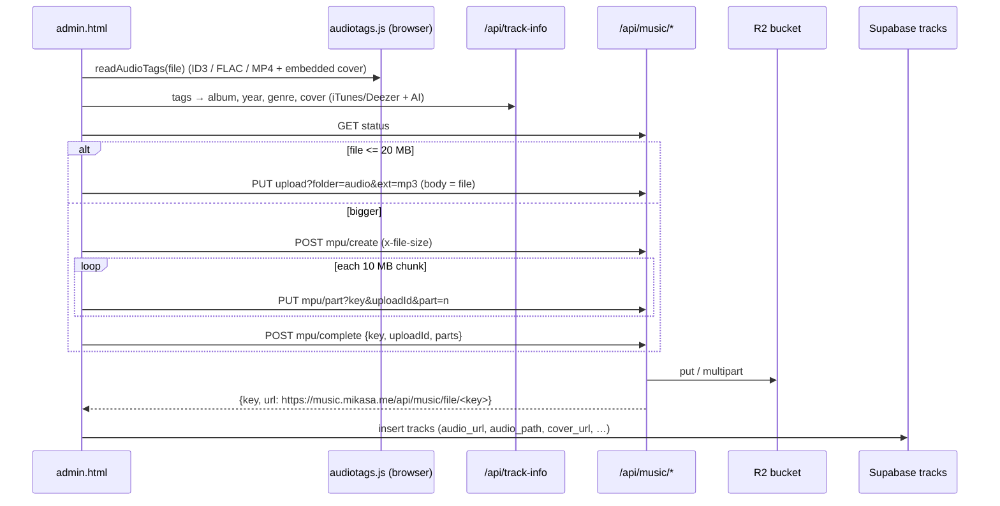

# Music system (Basement radio, player, charts)

Audited 2026-11-17. All limits below are copied from the code.

## Limits

| Limit | Value | Where |
| --- | --- | --- |
| Max song size, R2 | **100 MB** (`MAX_BYTES = 100 * 1024 * 1024`) | `functions/api/music/[[path]].js`; admin `MAX_SONG` |
| Max song size, Supabase Storage fallback | **25 MB** (`26214400`) | bucket `music` in `supabase/music.sql`; admin `MAX_AUDIO` default |
| Single-request upload to R2 | up to 95 MB (`SINGLE_PUT_MAX`) | function |
| Chunk size (multipart) | 10 MB (`chunkBytes` from `/api/music/status`) | function + admin `CHUNK` |
| Max part accepted | 50 MB (`PART_MAX`) | function |
| Admin switches to chunked upload | file > 2 × chunk (20 MB) | admin `uploadToR2` |
| Max cover image | 5 MB | admin `MAX_COVER` |
| Audio types | MP3, M4A/MP4/AAC, OGG, WAV, FLAC (`AUDIO_TYPES`) | function + bucket MIME list |
| Track duration | 0–7200 s | `tracks` check |

Cloudflare limits a single request body to 100 MB, which is why large files go through multipart.

## Storage: R2 first, Supabase fallback
- **Detection:** the admin calls `GET /api/music/status` → `{ r2: !!env.MUSIC, maxBytes, chunkBytes }`. With `r2: true` it uploads to R2 and allows 100 MB. Otherwise it uploads to the Supabase bucket `music` (public, 25 MB).
- **R2 setup** (owner, in the Cloudflare dashboard):
  1. R2 → create bucket `underground-music`.
  2. Pages project → Settings → Bindings → R2 bucket, variable **`MUSIC`**.
  3. Redeploy.
- **Status:** **PENDING verification.** The audit could not confirm the binding exists. Check admin → Music: the size hint says "max 100 MB" when R2 is on, "max 25 MB" when it is off. Or open `https://music.mikasa.me/api/music/status`.

## Upload flow (admin → Music)

- Object keys look like `audio/<uuid>.<ext>` or `covers/<uuid>.<ext>` (`KEY_RE`), so names are never guessable from the title.
- Admin routes (upload, mpu, delete, purge) need a session, `admin_users` membership and **aal2**.
- On failure the admin aborts the multipart upload (`mpu/abort`).
- Deleting a track also deletes its files (`POST /api/music/delete {keys}`, or the Supabase Storage remove for fallback files).
- Settings → Clean up data → Music uses `POST /api/music/purge` plus `ug_admin_purge(['tracks'])`.

## Metadata (`assets/audiotags.js`)
Runs in the browser with no upload. It reads:

- ID3v2.2 / 2.3 / 2.4 (MP3, some WAV and AAC) and ID3v1, including numeric genres
- FLAC Vorbis comments and pictures
- MP4 / M4A iTunes atoms (`covr`)

It returns `{title, artist, album, year, genre, picture}`. The embedded picture becomes the cover if no catalogue art is found. Then `/api/track-info` completes the details: see [AI-SYSTEM.md](AI-SYSTEM.md#music-metadata-post-apitrack-info-admin--2fa).

## Streaming
`GET /api/music/file/<key>` is public. It supports `Range` requests (206 partial content) so players can seek. Responses carry `cache-control: public, max-age=31536000, immutable`. HEAD is supported. R2 has no egress fees. If `MUSIC` is missing, the route answers 503 "Storage not connected".

## Player (public site)
- The **Music** view lists published tracks.
- The persistent mini player ("Floating Island" design) keeps playing while visitors browse.
- The **Now Playing** card has seek, previous/next, Up Next and star rating. Lock-screen controls come from the Media Session API.
- Chart hits from Deezer play through `/api/preview?id=<deezer id>`, which redirects to a fresh signed 30 s preview. Deezer preview URLs expire, so they are never stored.

## Charts and ratings
- **Community charts:**
  - Members rate tracks 1–5 stars (`track_ratings`).
  - `ug_chart_tracks` / `ug_chart_bands` with period `week` or `all` and an optional genre list. The score is a Bayesian average: `(sum + 3 × mean) / (votes + 3)`.
  - The home page shows the top 3.
- **Global charts:** `GET /api/charts`, cached 6 h (cache key `v=4`).
  - The default chart comes from Deezer's "Metal" playlists, with a fallback to the Metal genre artists.
  - `?group=<group>` or `?genre=<genre>` must match the shared taxonomy (`genres-data.js`); otherwise the route returns 400.
  - Bands are ranked by fans, hits by popularity.
  - Deezer's placeholder images are skipped, and missing covers are filled by `/api/cover`.
- **Taxonomy:** 30 groups, about 415 genres, in `assets/genres.js` (browser, `window.UG_GENRES`) and `functions/api/genres-data.js` (server, `PROMPT_LIST`, `canonicalGenre`). **The two lists must stay identical.** Edit both in the same commit.

## Status

| Part | Status |
| --- | --- |
| Supabase upload path (≤ 25 MB) | IMPLEMENTED, NOT VERIFIED in this audit (it was the original path) |
| R2 upload and streaming up to 100 MB | IMPLEMENTED, NOT VERIFIED (binding not confirmed) |
| Tag reading + `/api/track-info` | IMPLEMENTED, NOT VERIFIED since 2FA was added |
| Player, Now Playing | IMPLEMENTED (owner chose and saw the design) |
| Global charts + playable previews | VERIFIED by owner (2026-11-16) |
| Community ratings and charts | IMPLEMENTED, NOT VERIFIED |
